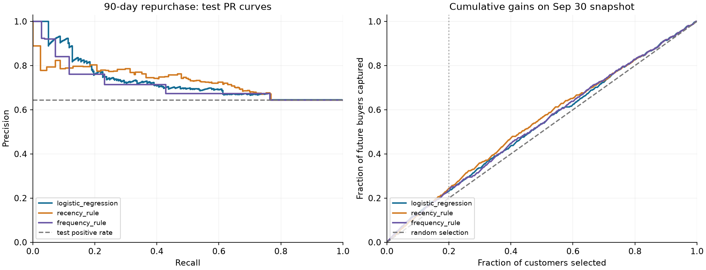

# Customer 360 ML — 90-day repurchase prediction

[](https://github.com/ZackingZ2006/customer-360-ml/actions/workflows/ci.yml)

Follow-up to [Customer 360](https://github.com/ZackingZ2006/customer-360). Question: at a cutoff date, which existing customers will place at least one completed order in the next 90 days? The main goal is to check whether ML is actually better than a simple rule.

🇻🇳 Notebook có giải thích tiếng Việt: [Customer360_ML.ipynb](Customer360_ML.ipynb)



## Result

Test cutoff 2025-09-30, 489 customers, 64.4% repurchased.

| Model / rule | Average Precision | Precision@20% | ROC-AUC |
|---|---:|---:|---:|
| Logistic Regression (chosen on validation) | 0.729 | 74.5% | 0.579 |
| Recency rule (most recent buyers first) | 0.729 | **78.6%** | 0.606 |
| Frequency rule (chosen on validation) | 0.712 | 76.5% | 0.583 |
| Base rate | 0.644 | 64.4% | 0.500 |

- Logistic Regression beats the rule picked on validation by +0.016 AP (bootstrap 95% CI 0.005–0.028).
- But the recency rule gets the same AP and a higher Precision@20%.
- **Conclusion:** on this data, ML is not clearly worth replacing a simple rule.

## Method

| Split | Cutoff | Label window | Customers |
|---|---|---|---:|
| Train | 2025-03-31 | 04-01 → 06-29 | 283 |
| Validation | 2025-06-30 | 07-01 → 09-28 | 397 |
| Test | 2025-09-30 | 10-01 → 12-29 | 489 |

- One row = one customer at one cutoff. Features come from the 90 days up to the cutoff: recency, order counts, revenue, average and max order value, number of channels, and active 30-day blocks.
- Each split's labels end before the next split's cutoff. There is no random split.
- Two fixed models: Logistic Regression (`C=1`, scaler inside the pipeline) and Random Forest (300 trees, depth 4). Model and rule are both chosen on validation, then scored once on test.

`test_temporal_integrity.py` checks that:
- changing future orders does not change the features,
- window boundaries are correct,
- customers without a full 90-day label window are rejected,
- cancelled orders are not counted,
- there is one row per customer per cutoff.

## Run

```bash
pip install -r requirements.txt
python customer360_ml.py                      # writes results/
python -m unittest test_temporal_integrity -v
```

Input: `data/dim_customer.csv` and `data/fact_order.csv` (copied from Customer 360).

## Limitations

- Synthetic data: 600 customers, one year, one test cutoff. The results show the workflow, not real-world performance.
- The source has no `completed_at` date. The experiment assumes the final order status was known on the order date.
- A high score means the customer is likely to buy anyway. It does not mean a promotion will change their behaviour. Measuring that needs a controlled experiment.
